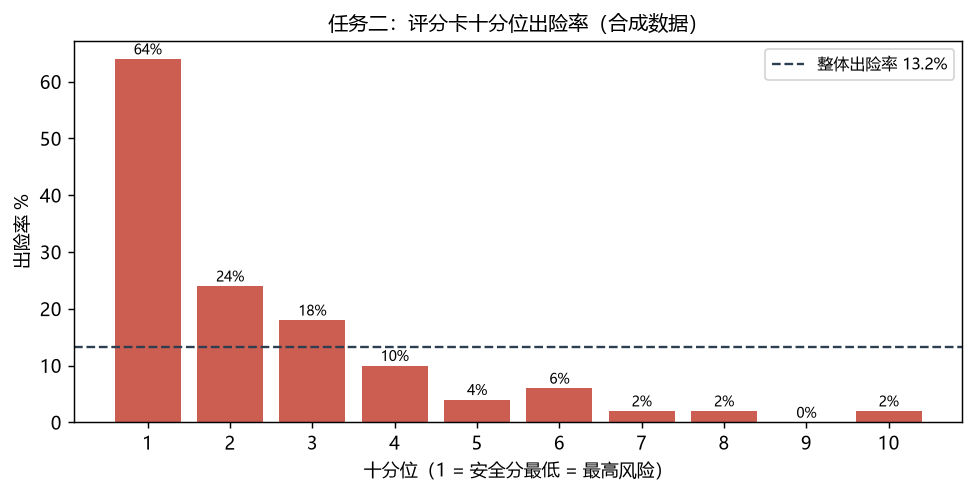

# 驾驶安全风险预测与可解释评分卡

用「历史驾驶行为事件 → 未来事故风险」做两件事：给出每台车的事故风险概率，再把它翻译成一张能逐项看懂的安全评分卡。

这个仓库的重点不是模型。**重点是五个看起来对、实际错的方法论陷阱，以及它们各自的量化偏差**——这些坑在跑的时候都不会报错，代码通、AUC 还挺高，错的是结论。

> 每个坑的完整分析（现象 / 量化 / 我自己怎么踩进去的 / 怎么处理 / 能不能迁移到别的项目）见 **[docs/findings.md](docs/findings.md)**。README 是精简版。

> **数据说明**：仓库里所有数据都是**脚本生成的合成数据**，车号是虚构的，数字不代表任何真实车队。原始比赛数据涉及企业车辆行驶轨迹与司机行为，受保密条款约束，不能公开。合成数据只保留结构（500 台车 × 61 天、8 个指标、同样的分表形态），让方法可以端到端跑通。



---

## 两分钟跑通

实测总耗时 **91 秒**（Windows 11 / Python 3.12.14，单核，含所有脚本）。

```bash
pip install -r requirements.txt

# 1) 生成合成数据（约 15 秒，输出到 data/synthetic/）
python scripts/generate_synthetic.py

# 2) 复现五个方法论陷阱的量化偏差（约 28 秒）
python scripts/demo_traps.py

# 3) 任务一：事故风险预测（按车分组交叉验证，约 8 秒）
python src/task1/run_task1.py

# 4) 任务二：可解释安全评分卡（约 26 秒）
python src/task2/run_task2.py

# 5) 不变量测试（17 项，约 3 秒）
python -m pytest tests -q

# 6) 校验文档里的结论是否仍成立（22 项断言）
python scripts/check_claims.py

# 7) 重新生成 docs/figures 里的图（需要 matplotlib）
python scripts/demo_traps.py --json outputs/metrics.json
python scripts/make_figures.py
```

不需要改路径。数据目录优先级：命令行 `--data` > 环境变量 `DSA_DATA_DIR` > 仓库内 `data/synthetic`。

支持 `--data` 的脚本：`demo_traps.py`、`make_figures.py`、`task1/run_task1.py`、`task2/run_task2.py`。`generate_synthetic.py` 是生成器，它用 `--out` 指定**输出**目录（以及 `--seed` / `--vehicles` / `--report-calibration`）。`check_claims.py` 用 `--json` 读 `metrics.json`。

装了 `make` 的话也可以一条命令跑完：`make all`（等价于上面 1~6 步）。

---

## 五个陷阱，以及它们值多少分

下面每个数字都可以用 `python scripts/demo_traps.py` 当场跑出来。**偏差量级是这套样本量（500 台车、66 个正例）下的实测值，不是通用常数。**

### 陷阱一：暴露量混杂 —— 这个特征测的是「跑得多」还是「开得危险」？

里程本身对标签的 AUC 就有 **0.8074**。也就是说，什么都不用预测，只按「谁跑得多」排序就能拿到 0.81 的 AUC。

于是任何与里程强相关的特征都会「自带」预测力。实测：

| 特征 | 原始 AUC | 对数—对数残差化后 |
|---|---|---|
| 轨迹采样点数（纯暴露量，不含任何行为信息） | 0.8080 | **0.4995** |
| 事件总条数（暴露量 × 行为率） | 0.8902 | 0.7606 |

采样点数与里程的 Spearman 是 **+0.9995**，它本质上就是里程的另一种写法。残差化之后掉到 0.4995——刚好是随机水平，说明它一点行为信号都没有。

事件条数残差化后还剩 0.7606，说明里面确实有真信号，但**无法靠残差完全分离**。

> **这里我自己踩过一个坑**：最初用「原始计数 对 log(里程) 回归」做残差，采样点数的残差 AUC 还能到 0.61。原因是计数随里程近似幂律增长，对 log 回归后残差里仍留着一条单调曲线，看起来像信号，其实是回归形式选错。改成对数—对数之后掉到 0.50。脚本里同时打印两个口径，就是为了留下这个对照。

**结论**：最终评分体系全部改用「率」（事件数 / 里程），暴露量在分母里约掉。对照一下，最强率指标车道偏移的 AUC 是 **0.8215**——比纯里程的 0.8074 只高一点，但这 0.014 才是真正的行为信号。

### 陷阱二：特征选择偏差 —— 既挑特征又评性能，AUC 会虚高

在全样本上按重要性挑出 top-k，再用同一批数据交叉验证评估：

| 口径 | OOF AUC |
|---|---|
| 朴素（全样本排重要性） | 0.8744 |
| 嵌套（折内排重要性） | 0.8649 |
| | **乐观偏差 +0.0095** |

偏差真实存在，但只有 0.0095——因为这里用的是树模型重要性，本身不算强选择器。

**更值得说的是 top_k 扫描**：top_k 从 4 扫到 22，AUC 分别是 0.8682 / 0.8593 / 0.8649 / 0.8720 / 0.8639 / 0.8611，最高在 top_k=12（0.8720）。但整条曲线只在 **0.0127** 的范围内来回波动，没有单调趋势。在 66 个正例的样本量下这个量级的跳动基本是噪声——所以正确结论是「挑几个特征对泛化没有稳定影响」，而不是「top_k=12 最好」。**拿 top_k 扫描的排名当结论，是这类比赛里最常见的过度解读。**

### 陷阱三：共线性符号反转 —— 系数与常识反号时该怀疑什么？

8 个指标一起回归，先看 VIF：

```
分神 1.53 / 车道偏移 1.51 / 吸烟 1.24 / 盲区报警 1.21
碰撞预警 1.17 / 超速 1.16 / 疲劳 1.15 / 设备异常 1.05
```

全部远低于 5 的警戒线，**没有严重共线性**。这一点很重要：很多人一看到系数反号就归因「共线性严重」，但这次实测不支持。

然后是一个容易被忽略的事实——**单个指标的系数符号本身就不稳定**。B=200 次车辆重抽样，统计「系数为正（即事件越多越危险，符合常识方向）的占比」：

| 指标 | 占比 | 判读 |
|---|---|---|
| 疲劳 | 100.0% | 稳 |
| 车道偏移 | 100.0% | 稳 |
| 超速 | 99.5% | 稳 |
| 设备异常 | 72.0% | **不稳** |
| 分神 | 68.0% | **不稳** |
| 碰撞预警 | 61.5% | **不稳** |
| 盲区报警 | 21.0% | **多数反号，但也不稳** |
| 吸烟 | 1.5% | 稳定反号 |

（吸烟与盲区报警在合成数据里被**刻意**设成负向，用来复现真实项目里观察到的方向反常；其余六个指标的"真实方向"都是正的。）

在 500 台车、几十个正例的量级下，**分神、碰撞预警、设备异常这三个指标的符号有约 28~39% 的重抽样会翻向**。这意味着：某一次拟合出来「分神系数是负的」，根本不能当成「分神有害」的证据，换个种子就没了。

注意倒数第二行：盲区报警的 21.0% 意味着**有 79% 的重抽样是反号的**，但它没到 95% 的稳定线。所以它的正确表述是「多数情况下反号，但方向本身也不牢靠」——既不能说它稳定有害，也不能说它稳定有益。这种"两头都不占"的指标，最容易被写作时按需要挑一个方向来讲。

处理优先级（脚本里也写了）：

1. 先做排除法，确认是不是被强指标吸收；吸收不了的别硬解释。
2. 是吸收 → 符号约束回归（风险因素系数强制 ≥ 0），或按维度分组建模。
3. 不是吸收 → 如实披露为「方向待核实」，**不要翻译成行为建议**。

第 3 条最容易被违反。真实项目里「吸烟事件越多、出险率越低」这个反常识结果，一旦被写成「建议适当吸烟」就是灾难。正确做法是标注为方向待核实，从评分卡里移除或做符号约束，而不是给它编一个解释。

### 陷阱四：分箱泄漏 —— WOE 分箱偷看了标签，评估会乐观多少

| 口径 | OOF AUC |
|---|---|
| 全样本分箱（有泄漏） | 0.8555 |
| 折内分箱（无泄漏） | 0.8390 |
| | **乐观偏差 +0.0165** |

凡是「用标签做的离散化」都有这个坑：WOE/IV、最优分箱、目标编码。正确姿势是分箱边界只能从训练折学，验证折照抄。这条在评分卡项目里尤其容易犯，因为分箱和建模通常写在两个脚本里，跨脚本的泄漏肉眼很难发现。

> **一个必须避开的算法陷阱**：不要拿「前代口径的全样本分」减「末代口径的无泄漏分」当泄漏量——那样会把**版本差异**算进泄漏里。正确做法是同一批数据、同一套超参、同一个随机种子，只切换「分箱在折内还是折外」这一个变量。本仓库全部按后者做。

### 陷阱五：加总身份不成立 —— 评分卡就没法审计

评分卡声称「总分 = 基准分 + 各项得分」，但实际算出来对不上：曾出现差 **774.8** 和 **1106.8**。

三个根因，都不是崩溃，而是静默失效：

1. **把箱序号当 WOE 喂进回归**。结果是八个指标里六个系数变正、全被符号约束截断为 0，包括车道偏移这种最强指标。评分失去区分度，加总也对不上。
2. **加总校验重复计数**。逐项明细的 DataFrame 已经含汇总列「安全分」，校验时对整表求和就把汇总列加了两次。
3. **刻度设计让基准分不可控**。常规 `score = BASE - factor × (Σβ·WOE + β0)` 使基准分完全由 β0 决定，算出来是 236.8。

修法是锚定中位车（见下文任务二）。判据很硬：**逐项加总与总分的差必须精确为 0（浮点误差内）**。差 0.2 是舍入残留，差 774.8 是结构错误——两者都要查，但不能混为一谈。

---

## 任务一：事故风险预测

`src/task1/run_task1.py`

- **特征**：17 维——8 个指标的每千公里率、速度均值、夜间行驶占比、IMU 4 类事件率、IMU 覆盖率。
- **验证**：`StratifiedGroupKFold` 按车分组。同一台车的样本绝不能同时出现在训练折和验证折，否则模型记住的是车而不是规律。
- **融合**：秩融合而非概率平均。不同模型的输出校准程度不同，直接平均概率等于默认它们可比。

实测（合成数据，500 台车，正例 66 台 = 13.2%）：

| 模型 | OOF AUC |
|---|---|
| LR-L1 | 0.8618 |
| ExtraTrees | 0.8531 |
| RandomForest | 0.8367 |
| **三模型秩融合** | **0.8557** |

值得注意：融合（0.8557）**没有超过最好的单模型**（LR-L1 0.8618）。这在样本量小、模型间相关性高的时候很正常——融合降低方差，但不会凭空创造信息。很多比赛报告只写融合结果不写单模型，读者会误以为融合一定更好。

输出列说明：`risk_score` 是秩融合的原始秩均值（值域约 1~N），`risk_prob` 是把它线性映射到 [0,1] 后的**相对位置**，不是校准后的出险概率。要得到真正的概率需要额外做校准（Platt / isotonic），本仓库没有做——把秩分挂在 `risk_prob` 这个名字下曾经是个真实的误导。

## 任务二：可解释安全评分卡

`src/task2/run_task2.py`

标准 WOE 评分卡，8 个指标、每指标 2~5 箱（单调约束）、符号约束（风险因素系数强制 ≥ 0）、逐项得分明细。

实测（合成数据）：

| 项目 | 数值 |
|---|---|
| OOF AUC（折内分箱，无泄漏，逐折平均口径） | **0.8390 ± 0.0027** |
| OOF AUC（折内分箱，无泄漏，拼池口径） | 0.8350 ± 0.0042 |
| OOF AUC（全样本分箱，有泄漏） | 0.8465（乐观偏差 +0.0075 / +0.0115） |
| 逐项加总 vs 总分 最大差 | **0.000000** |
| 分档出险率（高/中/低） | 32.3% / 6.0% / 1.2% |
| 十分位 Spearman | −0.9510 |

### 为什么同一个模型要报两个无泄漏 AUC

`oof_auc` 把各折的验证分拼成一个向量算全局 AUC 时，会带上跨折常数污染：每折的基准分按**该折训练集中位原始分**锚定到 700，五折基准分彼此不同（实测 seed=0 为 183.5 / 134.1 / 122.8 / 96.9 / 128.3）。拼池等于给不同折加不同平移。

已核验这**不是标签泄漏**——各折基准分与各折测试集正例率的 Pearson r = −0.085，基本无关。但它确实让 pooled 带上口径噪声，所以两种口径都报：拼池 0.8350、逐折平均 0.8390、每折中心化 0.8264（三种口径在同协议同一批种子上跑出，差异约 ±0.007，属口径选择而非泄漏）。

只报一个数的风险是：读者会以为那是唯一正确值，换个折算方式就对不上账。

### 刻度设计：把中位车锚定在 700 分

常规做法是 `score = BASE - factor × (Σβ·WOE + β0)`，基准分完全由 β0 决定。这个做法在真实项目里算出的基准分是 236.8——业务方看不懂，也没法解释「为什么满分不是 1000」。

这里改成**锚定中位车**：中位车的安全分定为 700，`基准分 = 700 − median(raw_score)`。好处有两个：分数范围可控、业务方可理解；以及 `总分 = 基准分 + Σ各项得分` 恒成立，逐项加总能对得上账（上面那个 0.000000 就是这么来的）。评分卡能不能被审计，取决于这个恒等式成不成立。

### 一个方向性 bug，值得单独说

初版 `leaky_auc` 用 `decision_function` 再取负，算出泄漏 AUC = 0.1535、乐观偏差 −0.6815——数字荒谬到一眼能发现，但如果偏差是 +0.02 这种量级就发现不了。

根因是方向混用：**安全分越高越安全，风险概率越高越危险，两者方向相反**。混用会把 AUC 悄悄变成 1−AUC，不报错、不崩溃，只是结论全反。现在两个函数各自在 docstring 里写清了方向约定。

---

## 这个仓库诚实地不做什么

| 项目 | 状态 |
|---|---|
| 用真实数据复现 | **不做**。原始数据受保密约束，仓库里没有一行真实数据 |
| 声明「模型可用于生产」 | **不声明**。500 台车、几十个正例，任何 AUC 的置信区间都很宽 |
| 提供独立测试集指标 | **没有**。所有 AUC 都是交叉验证的自评，没有留出独立测试集 |
| 因果结论 | **不给**。评分卡是排序工具，不是因果模型。「车道偏移扣分最多」不等于「减少车道偏移就能降低事故」 |
| 行业基准对比 | **没有**。本项目不引用任何外部行业事故率数据 |

### 已知的七个方法论问题

这些是原项目做完之后自己列出、并且没有完全解决的问题。写在这里而不是藏起来，因为它们决定这些数字能怎么用：

1. **无独立测试集**——所有 AUC 都是 OOF 自评。
2. **标签是「同期」而非「未来」**——原始赛题要求「未来事故风险」，但可用标签与特征在时间上重叠，严格说是同期关联而非前瞻预测。
3. **大量特征是里程代理**——陷阱一量化了这一点，但残差化只处理了线性部分。
4. **IMU 覆盖率仅 48.7%**——近一半车辆没有可用的传感器数据，这本身与车辆类型/用途相关，构成选择偏差。
5. **样本量不足**——500 台车、66 个正例，符号稳定性表就是直接证据。
6. **特征高度冗余**——原始特征集有 300+ 对 |r| > 0.9。
7. **十分位有轻微反转**——第 5、6 档出险率 4% → 6%，非严格单调。

---

## 目录结构

```
data/synthetic/        合成数据（8 个文件，约 12MB）
  event_daily.parquet      车辆 × 日 × 事件类型 的计数
  traj_daily.parquet       轨迹日聚合（含 spd_bin_* 速度直方图）
  imu_daily.parquet        IMU 日聚合统计量
  imu_events_daily.parquet IMU 风险事件计数
  labels.csv               标签（事故次数 / 未遂次数 / 正例标记）
  task2_candidates.csv      8 个评分指标的每千公里率
  vehicle_profile.csv       车辆画像（能源类型、里程、时段占比等）
  features_events.csv       事件总数
docs/schema_snapshot.json  各表的列名、类型与真实行数（结构参照）
docs/findings.md           五个坑的完整分析（现象 / 量化 / 处理 / 可迁移性）
docs/figures/*.png         上面几节的图，由 scripts/make_figures.py 生成
scripts/
  generate_synthetic.py    合成数据生成器
  demo_traps.py            五个陷阱的量化演示（本仓库的核心）
  check_claims.py          断言文档里的结论仍成立（CI 用）
  make_figures.py          生成 docs/figures 里的图
  anonymize.py             车号脱敏工具
src/
  paths.py                 路径解析与数据装载
  task1/run_task1.py       任务一：风险预测
  task2/run_task2.py       任务二：评分卡
tests/test_core.py         17 项不变量测试（不钉数字，钉性质）
outputs/                   运行产物
```

### 关于测试：只钉不变量，不钉数字

`tests/test_core.py` 里的 17 项测试**没有一个断言具体 AUC**。原因很直接：AUC 会随随机种子和 sklearn 版本漂移，钉死数值的测试过几天就红，然后被人一键跳过，从此失去意义。

钉的是性质，例如：分箱边界严格递增、每个样本恰好落在一个箱里、箱内出险率单调、符号约束后所有 β ≤ 0、逐项加总恒等于总分、中位车分数恒为 700 分刻度、`woe_transform` 与 `apply_bins` 结果一致、脱敏跨文件一致且不保序。

其中一个是 `flip_case` 夹具：它显式搜索能产生反号系数的种子，**搜不到就 `pytest.fail`**，而不是让测试看起来通过。

> **写测试时被自己的测试打回三次**，其中一次推翻了我的一个假设：我原以为「把指标设成负向就能复现反号系数」，实测发现**WOE 分箱本身会吸收方向**——指标值越大出险率越高时 WOE 自动变低，回归系数自然为负。所以标准 WOE 评分卡里「反向指标」并不会产生反号系数，真正的反号只来自**抑制效应**（两个指标高度相关、其中弱者边际贡献转负）。这个发现改写了我对陷阱三的解释。

### 关于 `check_claims.py`：文档也会说谎

`tests/` 保证代码不坏，但**代码不坏不等于文档没在说谎**。文档里的数字会随依赖升级、种子变化、合成参数调整而慢慢失准，而 CI 只跑「脚本没报错」的话，这种失准永远不会被发现。

`scripts/check_claims.py` 把 README 和 docs 里公开的结论写成 22 条断言，专门钉**性质**而不是精确值：朴素必须比嵌套乐观、纯暴露量残差化后必须接近 0.5、最大 VIF 必须远低于 5、三档符号稳定性必须互斥、泄漏偏差必须在同量级……

它已经抓出过一个真实错误：我最初把「盲区报警」标成「稳定反号」，但它只有 79% 的重抽样反号，没到 95% 的稳定线。这个错误读一遍是查不出来的——**表格里每一行单看都对，错在分档之间不互斥**。

> 钉精确值（如 `auc_km == 0.8074291300097751`）是错的：CI 会在每次依赖升级时变红，然后被加 `skip`，从此失去意义。所以这里的阈值都留了余量（如残差 AUC 判 `|x−0.5| < 0.06`）。

### 关于 CI：为什么工作流不在 `.github/workflows/`

工作流定义放在 **[docs/ci/ci.yml](docs/ci/ci.yml)**，而不是 `.github/workflows/ci.yml`。

原因很实际：往 `.github/workflows/` 写文件需要 GitHub token 带 `workflow` scope，我这次用的细粒度 token 没开这个权限，`git push` 直接被 GitHub 拒绝：

```
! [remote rejected] main -> main (refusing to allow a Personal Access Token
  to create or update workflow `.github/workflows/ci.yml` without `workflow` scope)
```

不想为了一个配置文件去要更高的权限，所以先放在 `docs/ci/`，**内容与可直接使用的版本完全一致**。

要启用它，二选一：

```bash
# 方式一：浏览器里新建文件，把 docs/ci/ci.yml 的内容粘进
#   .github/workflows/ci.yml

# 方式二：给 token 补 workflow scope 后
mkdir -p .github/workflows && cp docs/ci/ci.yml .github/workflows/ci.yml
git add .github/workflows/ci.yml && git commit -m "启用 CI" && git push
```

CI 做的事：Python 3.11 / 3.12 两档矩阵，**先清空 `data/synthetic` 与 `outputs`**，再从零跑生成器 → 陷阱演示 → 任务一 → 任务二 → 17 项测试 → 22 条结论断言。清空这一步是关键，否则 CI 可能一直在用仓库里已提交的产物，检查不出「生成器已经跑不出这份数据」这类退化。

## 脱敏工具

`scripts/anonymize.py` 把真实车号换成 `VEH_cd81d4c3` 这类代号，保持跨文件一致性，且不可逆：

```bash
python scripts/anonymize.py 评分结果.csv 脱敏后.csv
```

代号直接由 `sha256(SALT + 车号)` 派生，所以**同一个车号在任何文件里都得到同一个代号**，与文件里有几台车无关。实测：全量 500 台与 400 台子集、50 台子集交叉比对，代号不一致数为 **0**。

不可逆性实测：真实车号数值与代号哈希值的 Spearman 在三个号段分别是 +0.0776 / −0.0397 / +0.0860（p 均 > 0.05），确认序号不泄露大小关系。

### 这个工具被实测打回了两次

- **第一版**用 `hash % 500` 把车号塞进 500 个坑。500 个坑装 500 个球，按生日问题必然撞号——实测直接输出「映射冲突」。
- **第二版**改成「按哈希排序后依次分配 `VEH_0001`、`VEH_0002`……」，单文件内确实唯一，但**代号取决于这份文件里有多少辆车**。实测：全量 500 台与子集 400 台跑出来，**397 个代号不一致**。只要两份文件的车号集合不同（比如评分结果 50 台、明细表 500 台），同一个司机就会有两个代号，跨文件彻底对不上账。
- **第三版**（当前）代号由哈希直接派生，与文件内容无关。碰撞概率约 3e-5，真撞了会直接报错并提示加宽位数，不会静默把两个司机合并成一个。

这个问题值得单独写出来，因为它第一版第二版都「能跑、不报错、看起来对」，只有在跨文件对账时才会暴露。

---

## 环境

实测通过：Python 3.12.14 / numpy 2.3.5 / pandas 3.0.1 / scikit-learn 1.9.1 / scipy 1.18.1 / pyarrow 26.0.0（Windows 11）。

## 许可

代码 MIT。合成数据由本仓库脚本生成，可自由使用。
