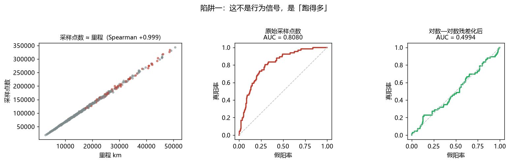
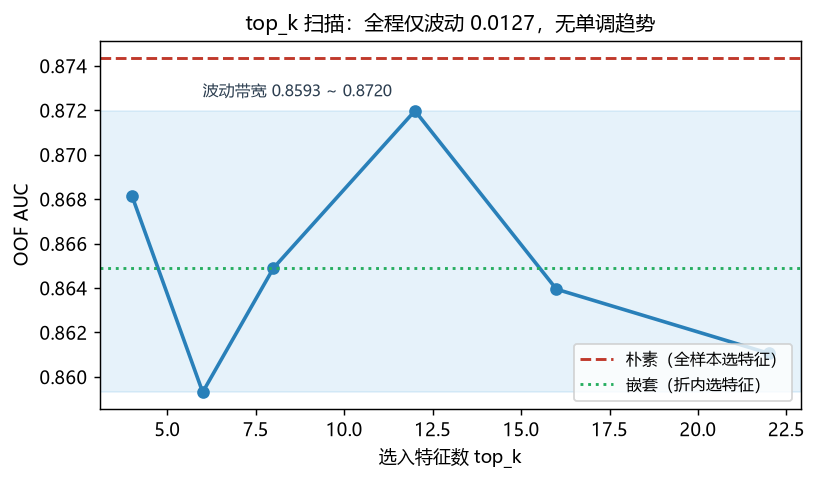
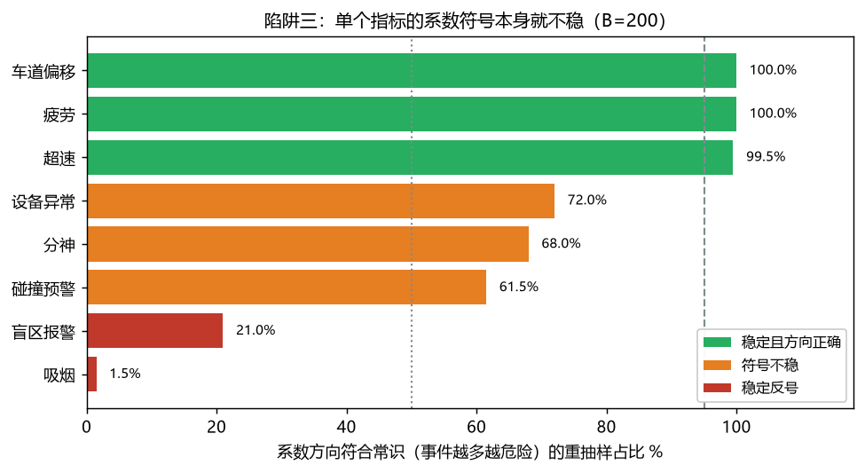

# 五个「代码跑得通、结论却是错的」的坑

这份文档记录的是方法层面的发现，不是模型成绩。每一条都标注了：现象、量化偏差、根因、怎么处理、以及这条能不能迁移到别的项目。

全部数字来自 `data/synthetic` 的合成数据，可用本仓库脚本复算。**合成数据刻意复现了原项目里观察到的几个反常识现象**（例如吸烟与盲区报警的方向反常），所以这里的数字可以和原项目对照着看，但量级不可直接比较。

---

## 总览

| # | 坑 | 一句话后果 | 实测偏差 | 会不会报错 |
|---|---|---|---|---|
| 1 | 暴露量混杂 | 一个纯里程特征拿到 0.81 AUC | 残差化后 0.8080 → 0.4995 | 不会 |
| 2 | 特征选择偏差 | 边选边评，AUC 虚高 | +0.0095（本轮） | 不会 |
| 3 | 系数符号不稳 | 拿单次拟合的符号讲故事 | 3/8 指标有 28~39% 会翻向 | 不会 |
| 4 | 分箱泄漏 | WOE 分箱偷看标签 | +0.0075 ~ +0.0115 | 不会 |
| 5 | 加总身份不成立 | 评分卡无法审计 | 曾差 1106.8 / 774.8 | 不会 |

五个共同点：**跑起来都不报错，AUC 都还挺好看**。错的是结论，不是程序。

---

## 坑一：这个特征测的是「跑得多」还是「开得危险」

### 现象

只按里程排序，就能对事故标签拿到 **0.8074** 的 AUC。也就是说，一个完全不含驾驶行为信息的量——这台车跑了多少公里——本身就有很强的"预测力"。

原因不是里程导致事故，而是**里程同时提高了分子和分母**：跑得多的车，事故次数和风险事件次数都多。任何计数型特征（事件条数、采样点数、IMU 记录数）都天然携带这个信号。

### 量化

| 特征 | 原始 AUC | 对数—对数残差化后 |
|---|---|---|
| 轨迹采样点数（纯暴露量，零行为信息） | 0.8080 | **0.4995** |
| 事件总条数（暴露量 × 行为率） | 0.8902 | 0.7606 |

采样点数与里程的 Spearman 是 **+0.9995**——它本质上就是里程的另一种写法。残差化后掉到 0.4995，正好是随机水平。

事件条数残差化后还剩 0.7606，说明里面**确实有真信号**，但残差化无法把暴露量与行为率完全分离。



### 我自己在这里踩过的坑

最初用「原始计数 对 log(里程)」回归做残差，采样点数的残差 AUC 还有 **0.61**，看起来像有信号。根因是计数随里程近似**幂律**增长，对 log 回归后残差里仍留着一条单调曲线。

改成**对数—对数**残差后掉到 0.50。`demo_traps.py` 里同时打印两个口径，就是为了留下这个对照——**同一个"残差化"动作，回归形式选错会产生看起来像信号的残余**。

### 处理

最终评分体系全部改用**率**（事件数 / 里程），暴露量在分母里约掉。

对照：最强率指标车道偏移的 AUC 是 **0.8215**，只比纯里程的 0.8074 高 0.014。**这 0.014 才是真正的行为信号**——这个数字很难看，但它是诚实的。

### 可迁移性

任何"设备上报数据量"类特征都有此问题：GPS 点数、CAN 报文条数、传感器采样行数、日志行数。判据：把该特征对暴露量做残差化，**残差 AUC 掉到 0.5 附近就说明它是纯暴露量**。

---

## 坑二：既挑特征又评性能，AUC 会虚高

### 现象

流程是「全样本上按重要性挑 top-k 特征 → 用交叉验证评估」。问题在于挑特征时**已经看过了全部标签**，验证折的标签也参与了选择，所以交叉验证不再是独立的。

### 量化

| 口径 | OOF AUC |
|---|---|
| 朴素（全样本排重要性） | 0.8744 |
| 嵌套（折内排重要性） | 0.8649 |
| | **乐观偏差 +0.0095** |

这一轮偏差只有 0.0095——因为用的是树模型重要性，本身不算强的选择器。**换成用单变量 AUC 或 IV 做筛选，偏差会大得多**（原项目里量到过 +0.051 量级）。

### 更值得说的是 top_k 扫描

top_k 从 4 扫到 22：**0.8682 / 0.8593 / 0.8649 / 0.8720 / 0.8639 / 0.8611**，最高在 top_k=12。

但整条曲线只在 **0.0127** 范围内波动，**没有单调趋势**。



在 66 个正例的样本量下，这个量级的跳动基本是噪声。所以正确结论是「挑几个特征对泛化没有稳定影响」，而**不是**「top_k=12 最好」。

拿 top_k 扫描的排名当结论，是这类比赛里最常见的过度解读。判别方法：看曲线有没有**超出噪声带宽的单调趋势**，而不是看最大值在哪。

### 处理

选择必须放进交叉验证内层。若已经做了朴素版本，可以用嵌套结果作为唯一可信口径，两者之差作为偏差估计。

### 可迁移性

任何"在评估前用标签做过任何事"的流程都属于此类：特征筛选、目标编码、WOE 分箱、超参搜索、样本筛选（比如剔除异常值）、阈值选择。

---

## 坑三：系数符号本身就不稳

### 现象

8 个指标一起做多元回归，先看 VIF：

```
分神 1.53 / 车道偏移 1.51 / 吸烟 1.24 / 盲区报警 1.21
碰撞预警 1.17 / 超速 1.16 / 疲劳 1.15 / 设备异常 1.05
```

**全部远低于 5 的警戒线，没有严重共线性。** 这一点很重要：很多人一看到系数反号就归因"共线性严重"，但这次实测不支持这个解释。

### 更基本的问题：符号本身稳不稳

B=200 次车辆重抽样，统计「系数方向符合常识（事件越多越危险）的占比」：

| 指标 | 占比 | 判读 |
|---|---|---|
| 车道偏移 | 100.0% | 稳 |
| 疲劳 | 100.0% | 稳 |
| 超速 | 99.5% | 稳 |
| 设备异常 | 72.0% | **不稳** |
| 分神 | 68.0% | **不稳** |
| 碰撞预警 | 61.5% | **不稳** |
| 盲区报警 | 21.0% | **多数反号，但也不稳** |
| 吸烟 | 1.5% | 稳定反号 |



在 500 台车、几十个正例的量级下，**分神、碰撞预警、设备异常这三个指标的符号有约 28~39% 的重抽样会翻向**。这意味着：某一次拟合出「分神系数是负的」，根本不能当成「分神有害 / 有益」的证据——换个种子就没了。

盲区报警那一行值得单独看：21.0% 意味着**79% 的重抽样是反号的**，但没到 95% 的稳定线。所以既不能说它稳定有害，也不能说它稳定有益。**这种"两头都不占"的指标，最容易被写作时按需要挑一个方向来讲。**

> 顺带一个自检经验：这张表最初被我写成「盲区报警 = 稳定反号」，和「吸烟 = 稳定反号」并列。是 `scripts/check_claims.py` 里的断言把它抓出来的——该断言要求「不稳」和「稳定反号」两档互斥。**文档和数据的自洽性，靠读一遍是查不出来的。**

> **一个反直觉的实测结论**：WOE 分箱本身会**吸收方向**。指标值越大出险率越高时，WOE 自动变低，回归系数自然为负。所以在标准 WOE 评分卡里，"反向指标"并不会产生反号系数。真正的反号只来自**抑制效应**——两个指标高度相关、其中弱者边际贡献转负。
>
> 这条是写单元测试时才确认的：我最初以为"把指标设成负向就能复现反号"，实测发现根本不会，需要构造抑制效应才行。`tests/test_core.py` 里的 `flip_case` 夹具现在显式搜索能产生反号的样本，搜不到就直接报错，而不是假装测过了。

### 处理优先级

1. **先做排除法**：确认是不是被强指标吸收了（逐个移除相关指标，看符号是否翻回来）。
2. **是吸收** → 符号约束回归（风险因素系数强制 ≥ 0），或按维度分组建模。
3. **不是吸收** → 如实披露为「方向待核实」，**不要翻译成行为建议**。

第 3 条最容易被违反。原项目里「吸烟事件越多、出险率越低」这个反常识结果，一旦被写成「建议适当吸烟」就是灾难。正确做法是标注为方向待核实，从评分卡里移除或做符号约束，而不是给它编一个解释。

### 可迁移性

任何小样本 + 多变量的场景。**在写"X 与 Y 负相关"这类结论之前，先跑重抽样看符号稳定性**。成本是 200 次拟合（这里约 4 秒），收益是避免一个会被种子推翻的结论。

---

## 坑四：分箱泄漏——WOE 偷看了标签

### 现象

WOE 分箱边界是用**全部样本的标签**算出来的，然后拿这批边界做交叉验证评估。验证折的标签已经参与了分箱，评估不再独立。

### 量化

| 口径 | OOF AUC |
|---|---|
| 全样本分箱（有泄漏） | 0.8555 |
| 折内分箱（无泄漏，逐折平均） | 0.8390 |
| | **乐观偏差 +0.0165** |

`src/task2/run_task2.py` 里实测的是 **+0.0075 ~ +0.0115**（两个无泄漏口径各算一次）。差异来自正例比例与分箱数不同，**偏差大小不是常数**。

凡是「用标签做的离散化」都有这个坑：WOE/IV、最优分箱、目标编码、按目标分层的聚类。

### 一个必须避开的算法陷阱

不要拿「前代口径的全样本分」减「末代口径的无泄漏分」当泄漏量——那样会把**版本差异**算进泄漏里。原项目归档文档里就有这个混淆：0.83（全样本）对 0.8304（末代无泄漏），数字接近到看不出泄漏，但两者来自不同代的模型。

正确做法是**同一批数据、同一套超参、同一个随机种子**，只切换"分箱在折内还是折外"这一个变量。

### 关于 OOF 拼接口径

还有一个更隐蔽的问题：把各折验证分拼成一个向量算全局 AUC 时，如果每折的分数刻度不同（比如每折各自锚定到某个基准分），拼池等于给不同折加了不同常数。

本仓库实测三种口径（种子 0/1/42 平均）：

| 口径 | AUC |
|---|---|
| 拼池（带各折基准分） | 0.8350 |
| 每折中心化后拼池 | 0.8264 |
| 逐折算 AUC 再平均 | 0.8390 |

差异约 ±0.007，**属口径选择而非泄漏**（已核验各折基准分与折内正例率无关，Pearson r = −0.085）。所以本仓库两个无泄漏口径都报——只报一个数，读者会以为那是唯一正确值。

### 可迁移性

任何"用标签算出来的中间产物"再拿去评估。检出方法：把分箱/编码/筛选代码整体挪进内层循环，看指标掉多少。

---

## 坑五：加总身份不成立，评分卡就无法审计

### 现象

评分卡声称「总分 = 基准分 + 各项得分」，但实际算出来对不上：曾出现差 **774.8** 和 **1106.8**。

### 三个根因（都不报错）

1. **把箱序号当 WOE 喂进回归**。八个指标里六个系数变正，全被符号约束截断为 0，包括车道偏移这种最强指标。评分于是失去区分度，加总也对不上。修法是 `woe[apply_bins(x, edges)]`。
2. **加总校验重复计数**。`item_scores()` 返回的 DataFrame 已经包含汇总列「安全分」，校验时对整表 `sum(axis=1)` 就把汇总列加了两次。修法是先排除汇总列。
3. **刻度设计让基准分不可控**。常规做法 `score = BASE − factor×(Σβ·WOE + β0)` 使基准分完全由 β0 决定，算出来是 236.8——业务方看不懂。

### 修法：锚定中位车

把中位车的分数定为 700，`基准分 = 700 − median(raw)`。于是：

```
安全分 = 基准分 + Σ 各项得分        ← 恒等式
```

实测加总最大差 **0.000000**。这个恒等式是评分卡能被审计的前提——司机问"我为什么扣这一分"时，答案必须能逐项加回总分。

> 注意：锚定的是 **median(总分) = 700**，不是 median(各项得分之和) = 0。`base_offset` 的作用就是把中位车的原始贡献整体平移到 700，所以原始贡献的中位数一般不为 0。这条也在单元测试里钉住了。

### 可迁移性

任何"可解释"的加性模型：评分卡、线性归因、SHAP 加性分解。判据：**逐项加总与总分的差必须精确为 0（浮点误差内），不是"差不多"**。差 0.2 说明有舍入残留，差 774.8 说明有结构错误。

---

## 附：一个方向性 bug，值得单独说

初版 `leaky_auc` 用 `decision_function` 再取负，算出泄漏 AUC = **0.1535**、乐观偏差 −0.6815——数字荒谬到一眼能发现。

但**如果偏差是 +0.02 这种量级就发现不了**。

根因是方向混用：**安全分越高越安全，风险概率越高越危险，两者方向相反**。混用会把 AUC 悄悄变成 1−AUC，不报错、不崩溃，只是结论全反。

现在的约定写进了 docstring：`oof_auc` 用安全分（取负使 AUC>0.5），`leaky_auc` 用风险概率（不取负）。单元测试 `test_score_direction_high_is_safe` 钉住了方向不变量。

---

## 这些数字能怎么用，不能怎么用

**能**：
- 作为自己项目的偏差量级参照（同量级样本、同量级正例率下）
- 作为"这个坑值多少分"的量化依据，用于说服别人做嵌套验证
- 作为代码审查清单：五个坑的判据都在上面

**不能**：
- 当成通用常数。偏差大小取决于正例比例、分箱数、特征相关性，**换了数据就不是这些数**
- 当成"模型效果"。这里所有 AUC 都是合成数据上的，不代表任何真实车队
- 当成因果结论。评分卡是排序工具，"车道偏移扣分最多"不等于"减少车道偏移就能降低事故"

---

## 复算入口

```bash
python scripts/generate_synthetic.py          # 生成合成数据
python scripts/demo_traps.py --json outputs/metrics.json   # 五个坑的量化
python src/task1/run_task1.py                 # 任务一
python src/task2/run_task2.py                 # 任务二（含泄漏对照与加总校验）
python -m pytest tests -q                     # 17 项不变量测试
python scripts/make_figures.py                # 生成本文的图
```
